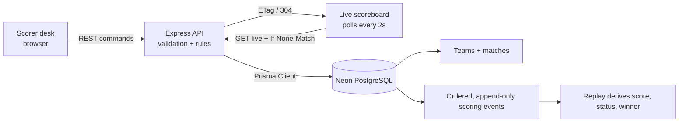

# Touchline — Live Football Scoring

A small, end-to-end association-football match centre: Express REST API, Neon PostgreSQL persistence through Prisma, a scorer's desk and a public live scoreboard. The browser polls on a fixed interval and uses ETags to skip unchanged match state.

## Requirements

- Node.js 20 or later
- A Neon PostgreSQL database
- npm

## Local setup

1. Copy `.env.example` to `.env` and set `DATABASE_URL` to your Neon pooled connection string. Set `DIRECT_URL` to the direct (non-pooler) Neon connection string for Prisma migrations. Keep both URLs private.
2. Install dependencies and generate Prisma Client:

   ```sh
   npm install
   npm run prisma:generate
   ```

3. Apply the checked-in migration and optionally seed a fixture:

   ```sh
   npm run prisma:deploy
   npm run db:seed
   ```

   For local schema iteration, use `npm run prisma:migrate -- --name describe-change`.
4. Start the server:

   ```sh
   npm run dev
   ```

5. Open [http://localhost:3000](http://localhost:3000). Create a fixture or select the seeded one. Start it, record a goal, pause/resume/end, and use **Undo latest goal** to see the reversal recorded without deleting history.

Run the scoring-engine tests with `npm test`.

## Environment variables

| Variable | Required | Description |
| --- | --- | --- |
| `DATABASE_URL` | Yes | Neon pooled PostgreSQL URL used by the application. |
| `DIRECT_URL` | Recommended | Direct Neon URL used by Prisma migrations. It may match `DATABASE_URL` if pooling is not used. |
| `PORT` | No | HTTP port (default `3000`). |
| `POLL_INTERVAL_MS` | No | Scoreboard polling interval in milliseconds; values below 1000 are clamped to 1000 (default `2000`). |

Never commit `.env` or database credentials.

## Architecture and scoring decisions



- A football match has two teams, a status (`SCHEDULED`, `LIVE`, `PAUSED`, `ENDED`), a score snapshot and a monotonically increasing version. Each event has a unique per-match sequence.
- The append-only event log is the source for score replay: goals add one for their team and a `GOAL_UNDONE` event references the goal being reversed. A goal is never deleted. Undo selects the most recent active goal.
- Match start/pause/resume/end and goals are validated server-side against the current lifecycle state. Commands update the match snapshot and append the audit event in one serializable database transaction, using the match version as a compare-and-swap guard.
- Football-specific event data includes team, optional player, match minute and added minute (for example, 45+2). This is a basic scorekeeper, not a full referee simulation: it does not model cards, substitutions, halves, extra time, penalties or VAR decisions beyond undoing a goal.
- The read endpoint replays events to derive score and status rather than trusting the cached score fields. Cached fields/version allow efficient updates and conditional polling.
- API input is validated with Zod. Helmet, a JSON body-size limit, request rate limiting and a centralized error handler are enabled. This starter has no scorer authentication; add identity and role checks before deploying to the public internet.

## REST API

All request and response bodies are JSON. Invalid input returns `400`; missing matches return `404`; invalid lifecycle transitions and conflicting updates return `409`.

| Method | Path | Description |
| --- | --- | --- |
| `GET` | `/api/health` | Health check. |
| `GET` | `/api/config` | Returns the configured polling interval. |
| `POST` | `/api/matches` | Create a fixture: `{"homeTeam":"Harbor FC","awayTeam":"Summit United"}`. |
| `GET` | `/api/matches` | List the latest 50 matches. |
| `GET` | `/api/matches/:id/live` | Current replay-derived state, teams, winner, goals and version. |
| `GET` | `/api/matches/:id/events` | Ordered audit trail, including goals later undone. |
| `POST` | `/api/matches/:id/start` | Start a scheduled match. |
| `POST` | `/api/matches/:id/pause` | Pause a live match. |
| `POST` | `/api/matches/:id/resume` | Resume a paused match. |
| `POST` | `/api/matches/:id/end` | End a live or paused match. |
| `POST` | `/api/matches/:id/goals` | Record a live goal: `{"team":"home","playerName":"A. Striker","minute":45,"addedMinute":2}`. `team` is `home` or `away`; minute is 1–120 and added minute 0–30. |
| `POST` | `/api/matches/:id/undo` | Append an event undoing the latest active goal; allowed while live. |

### Efficient polling

Poll `GET /api/matches/:id/live` at the interval returned by `/api/config`. The response includes a weak ETag such as `W/"match-id-12"`. Send it as `If-None-Match` on the next request; an unchanged match returns `304 Not Modified`, without a response body. The included viewer keeps its last rendered state on `304`.

## Production and demo

The app can be deployed to a Node host such as Render or Railway with `npm start`, a Neon database, and the environment variables above. Run `npm run prisma:deploy` as a release/deploy step, not on every server start. Terminate HTTPS at the platform proxy. Because scorer authentication is intentionally out of scope for this starter, keep the scorer interface on a trusted network until authentication and authorization are added.

Suggested 3–5 minute screen-recording walkthrough:

1. Create a match and show the fixture in the scoreboard.
2. Start the match; record home and away goals, including one added-time goal.
3. Show the timeline and score update without a page reload.
4. Undo the latest goal and show both the corrected score and retained audit history.
5. Pause, resume, end, then show a rejected invalid action or the final result.

The repository contains the runnable demo, but a screen recording must be captured in the target environment.
